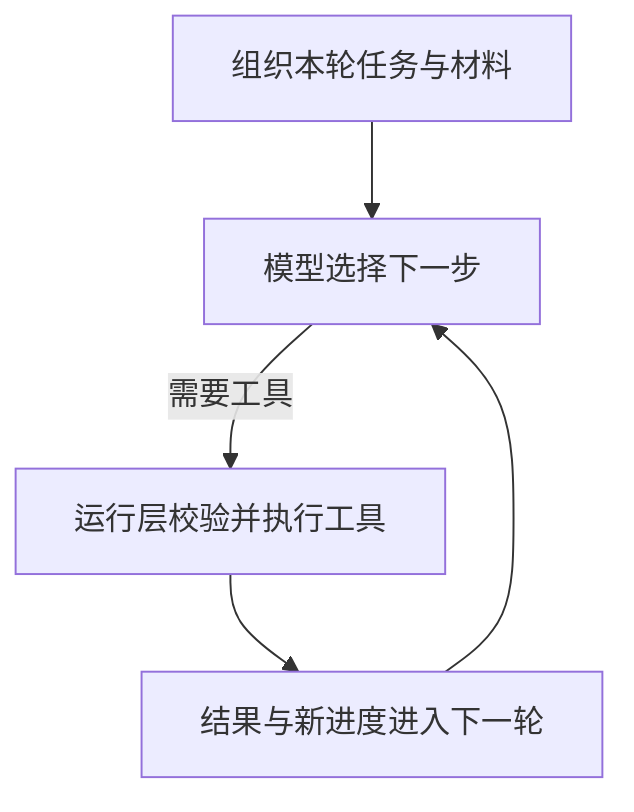
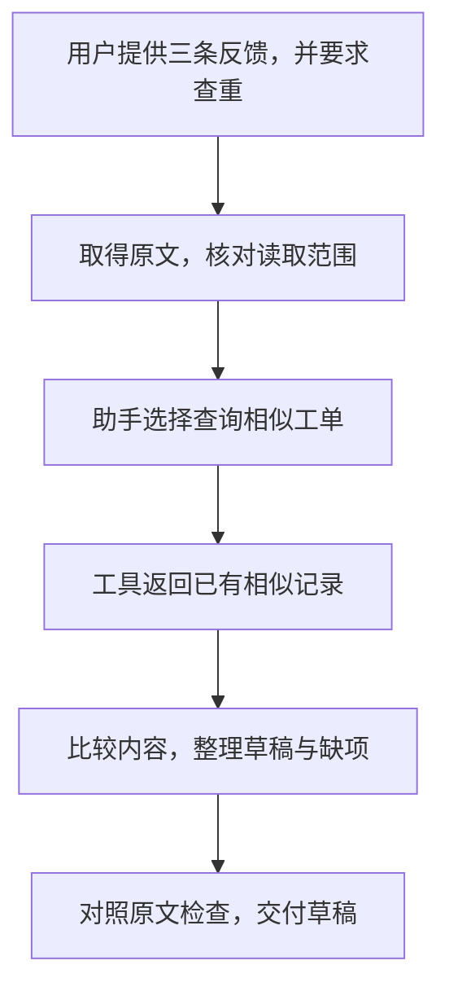

---
{"dg-publish":true,"dg-path":"Agent 应用指南/01 - Agent 如何工作.md","permalink":"/Agent 应用指南/01 - Agent 如何工作/","title":"Agent 应用指南（一）：一项任务如何变成连续行动","tags":["type/article","area/ai"],"created":"2026-10-12","updated":"2026-10-13","dg-note-properties":{"title":"Agent 应用指南（一）：一项任务如何变成连续行动","created":"2026-10-12","date":"2026-10-12","updated":"2026-10-13","tags":["type/article","area/ai"],"description":"从反馈分类到根据查询结果选择下一步，理解 Agent 的行动循环、上下文组成、Skill 与长任务压缩。","editorial_status":"待复审"}}
---


“把这批客户反馈整理一下，找出值得处理的问题。”

这项请求可以很简单：用户已经给出原文，只要分类。也可以更复杂：需要查已有工单，遇到缺项要追问，整理到一半还要根据新要求调整。

本系列面向普通开发人员和有少量技术背景的产品人员，解释 Agent 如何工作、如何设计、为什么失效，以及怎样发现失效。不讨论模型训练，也不要求先掌握某个框架。

我们用**客户反馈处理助手**贯穿全系列。以下输入、查询结果和草稿都是教学示例，不是已运行的产品。本例默认只交草稿；创建工单属于另一个需要具体授权的阶段。

## 1. 先分清：生成文字、固定工作流与 Agent

用户提供三句话：“导出文件时提示失败”“我也导不出来”“希望导出列表能按时间排序”，只要求分成两类。模型可以直接回答：前两条是故障反馈，后一条是功能建议。材料已经给全，没有外部动作，一次模型调用通常就够了。

如果任务需要查资料，也不自动意味着需要 Agent。程序可以固定执行“查询反馈 → 搜索工单 → 生成草稿”，这仍然可以是一条工作流。

本文所说的 Agent，是由模型在约束内选择下一步、通过工具推进任务的系统。比如查询后，模型根据结果选择继续比较、追问缺项，或直接交付草稿。关键不是有没有工具，而是**主要行动路径怎样决定**。[1]

| 形式 | 例子 | 下一步怎样确定 |
|---|---|---|
| 单次模型调用 | 对给定反馈分类或生成摘要 | 调用一次后结束 |
| 工作流 | 按规定顺序查询，再生成固定格式草稿 | 程序规定主要路径 |
| Agent | 根据查询结果选择继续查、追问或交草稿 | 模型在边界内选择行动 |

这不是严格互斥的产品分类。工作流也可以有条件分支和模型判断，Agent 也可以调用固定工作流。不能只凭“有循环”“有查询”或“用了多个模型”判断。

## 2. 模型负责提出行动，运行系统负责执行

一个最小可用的 Agent，可以从几个部件理解：

| 部件 | 做什么 | 在案例里是什么 |
|---|---|---|
| 模型 | 理解材料、选择下一步 | 判断要比较相似工单，还是追问缺项 |
| 任务与规则 | 定义目标、范围和停止条件 | 整理指定反馈，默认交草稿 |
| 工具 | 提供与外部系统交互的接口 | 查询反馈、搜索工单、读取实际记录 |
| 上下文 | 模型这轮实际收到的信息 | 当前请求、相关原文、查询结果、已加载的方法 |
| 状态 | 记录任务走到了哪里 | 已处理反馈、待补充事项、确认与执行记录 |
| 运行层 | 调模型、执行工具、检查权限、保存过程 | 把行动请求变成真实接口调用 |

运行层常被称为运行与控制框架（Harness）。现成框架可能提供这些功能中的一部分，但仍要核对当前配置是否真正支持。

模型提出“搜索工单”，不等于搜索已经发生。运行层要检查工具、账号、范围和参数，再调用接口；取回结果后，才交给模型继续判断。

## 3. 一次任务怎样沿着反馈继续

先看最核心的工具调用循环：



**图 1：工具结果进入下一轮，模型再选择行动。** 图中只画仍需要工具时的路径；材料已足够时可以核对草稿并交付，需要用户补充时应等待，而不是无限绕圈。调用被拒绝、预算耗尽或用户要求停止时，运行层应停止相关动作并说明原因。

把简单分类的请求增加一句：“查一下导出问题是不是已经有人登记，再给我草稿。”查询完成后，下一步可能不同：

| 得到的结果 | 模型可以选择的下一步 |
|---|---|
| 找到相似工单，但范围还不清楚 | 读取相关内容，比较是不是同一问题 |
| 本次查询没有找到相似项，范围与分页已核对 | 写草稿，注明“在本次查询范围未发现”，不保证全库绝无重复 |
| 工具提示还有下一页，或查询范围不明 | 继续核对覆盖情况；无法补全时说明不确定性 |

这些选择也可以被程序写成固定分支。需要 Agent 的理由，是现实任务中的材料和下一步经常变化，模型判断比维护大量固定规则更合适；不是因为查询这一步只能由 Agent 完成。[1][2]

### 一份能读懂的结果

假设本次查到“导出失败，待复现”的相似工单。草稿可以是：

> **导出问题：**两条反馈都提到失败，尚未确认是否同一原因。保留两条原文，标记已有工单疑似重复；软件版本、操作步骤和稳定复现情况待补充。  
> **排序建议：**按时间排序是功能建议，单列给产品人员确认。  
> **执行状态：**只生成草稿，没有创建或修改工单。



**图 2：一条具体路径，不是每次都固定如此。** 本例原文由用户提供，只有查重需要工具；若查询结果不同，比较、补充信息与交付的顺序也可能不同。

## 4. 模型每轮实际看见什么：上下文

**上下文（context）就是这一次模型调用实际收到的工作材料。** 不是磁盘里所有文件，也不是聊天界面能翻到的全部历史。运行层挑选并组织材料，下一轮可能加入新结果，移出旧内容。[3]

| 可能的组成 | 在本例中是什么 |
|---|---|
| 角色与行为规则 | 保留原文，不把未知情况写成事实 |
| 当前请求与相关对话 | 查重后交草稿；用户补充只看桌面产品 |
| 可用工具的说明 | 搜索工单需要项目和关键词，返回哪些信息 |
| 工具实际返回 | 查到“导出失败，待复现”的相似工单 |
| 检索到的资料 | 反馈原文、相关工单、产品术语 |
| 已加载的技能包（Skill） | 如何分类、保留来源、列出缺项的方法 |
| 取回的任务状态或记忆 | 已查过什么、还缺什么、哪些动作已发生 |

Skill 可以先理解为按任务取用的“操作手册”，不是额外派出一个助手。第二篇会展开它怎样被发现、读入和使用。

这是一张应用层清单，不是所有框架必须采用的固定字段协议；真实输入也可能有图片等非文本材料。工具说明不等于工具结果，资料保存过也不等于本轮已经读到。

### 具体例子：同一任务，两轮上下文怎样变化

用户说：“桌面产品收到‘导出失败’和‘希望列表按时间排序’两条反馈。查一下导出问题有没有重复，再给我草稿，不要创建工单。”

下面是简化的教学材料清单，不是某个框架的真实应用程序接口（API）请求，也不是模型内部思维过程。

**第一轮：查询之前。** 模型收到的材料可以这样理解：

```text
行为规则：只访问指定项目；不得虚构事实；本次不能写入。
用户请求：查询导出问题是否重复，整理两条反馈的草稿。
原文：一条“导出失败”；一条“希望列表按时间排序”。
可用工具：搜索工单，需要项目与关键词，返回匹配工单。
已加载的方法：故障与建议分开；查重后保留关联；未知项不猜。
```

模型可以提出行动：“在桌面产品项目中搜索导出失败的工单。”运行层校验并调用工具。**工具说明告诉模型能怎样查询，但没有告诉它查到了什么。**

假设工具返回：“找到一张‘导出失败，待复现’工单，缺少软件版本和操作步骤。”

**第二轮：拿到结果之后。** 必要的规则、请求、原文与方法仍需保留，本轮还增加：

```text
已执行动作：在桌面产品项目中搜索了导出失败的工单。
工具返回：有一张相似工单，尚未复现，缺版本和操作步骤。
任务状态：查重已做；尚未生成草稿；没有创建或修改工单。
```

这时草稿应保留疑似重复和缺项。改变结论的是**新加入的查询结果**，不是工具名称本身，也不是模型突然“想起来了”。

如果用户接着说“排序建议先不处理”，最新要求也应进入后续上下文。旧草稿或旧摘要中提到排序，不代表仍可按旧计划继续。

## 5. 长任务才需要进一步理解：compact

**上下文窗口**是单次调用能容纳的信息上限。文本通常以 token（模型处理文本的单位）计量，不简单等同于汉字数。长任务不断积累对话、资料和工具返回，需要给后续内容留空间。

上下文压缩（compaction，界面或命令中常写作 compact）把需要继续使用的历史整理成更短的表示。常见做法是用摘要替换较早历史，保留近期对话；具体触发、保留范围和表示形式取决于产品。Anthropic 使用摘要，OpenAI Responses 也有非人类可读的压缩项，不能把它们都当作同一种可读小结。[4][5]

只整理三条反馈，通常不需要关心这个机制。处理多批反馈、反复查资料和修改草稿时，才可能遇到：

> 压缩前：长段对话、查询结果、草稿讨论。  
> 后续仍需知道：只允许草稿；导出问题待核实；已查到相似工单；排序建议待确认；下一步补充草稿。

摘要可能遗漏细节。把“待确认的排序建议”缩成“已处理排序建议”，就会改变含义。**compact 不会扩大模型窗口，也不自动完成任务、获得授权或写入永久记忆。** 原历史仍可访问时，可以重读核对；不能假设压缩材料逐字保留了所有限定词。

重要任务还应有外部记录：原始材料在哪里、当前目标是什么、哪些动作已发生、用户批准了什么。第二篇讲怎样安排记录，第三、四篇讲怎样发现压缩后的遗漏。

## 6. 什么时候值得使用 Agent

先问：任务路径是否经常变化？是否需要结合文本与环境信息作选择？完成条件能否说清楚？

- 路径固定、规则明确：先考虑普通程序或工作流。
- 只需要改写、分类与摘要：先试单次模型调用。
- 路径随材料变化、目标可以验收：再考虑 Agent。
- 连目标都没定义：先澄清需求，不让 Agent 无限探索。

Agent 的灵活性通常伴随更多延迟、费用和失败面。OpenAI 与 Anthropic 都建议从简单可行的方案开始，不默认选择最复杂的编排，也就是模型与工具的协作安排。[1][2]

最后记住三个区别：知道工具怎么用，不等于已经接通；保存过历史，不等于这轮看到了；说“完成”，不等于外部结果已核实。

## 本篇小结

模型选择行动，运行层执行工具，结果进入下一轮上下文。Skill 提供可取用的方法，持久状态帮助跨轮继续；这些部件需要一起设计和验证。

下一篇把一句需求变成开发人员、产品人员和测试人员能够共同核对的设计。

## 来源与边界

- [1] Anthropic，**Building effective agents**，**What are agents?**、**When (and when not) to use agents**、**Agents**。支持主要路径预先规定与模型主导执行的区别；查询本身不是 Agent 的判定条件。https://www.anthropic.com/engineering/building-effective-agents
- [2] OpenAI，**A practical guide to building agents**，第 4 页 **What is an agent?**、第 5—6 页 **When should you build an agent?**、第 13 页 **Orchestration**、第 16 页 **When to consider creating multiple agents**。https://cdn.openai.com/business-guides-and-resources/a-practical-guide-to-building-agents.pdf
- [3] Anthropic，**Effective context engineering for AI agents**，**Context engineering vs. prompt engineering**。原文把系统指令、工具、外部数据和消息历史纳入上下文管理；本文映射到反馈助手，不声称各框架输入格式完全相同。https://www.anthropic.com/engineering/effective-context-engineering-for-ai-agents
- [4] Anthropic，**Compaction overview**，开头与 **Choose how to compact**；官方 Cookbook，**Context engineering: memory, compaction, and tool clearing → Compaction**。支持历史摘要、触发差异及细节丢失的边界。https://platform.claude.com/docs/en/build-with-claude/compaction ；https://platform.claude.com/cookbook/tool-use-context-engineering-context-engineering-tools
- [5] OpenAI，**Compaction**，**Overview**、**Server-side compaction**。压缩项可携带后续状态，且为不透明、非人类可读表示；本文不将其等同于可读摘要。https://developers.openai.com/api/docs/guides/compaction

以上是工程指南的定义与建议，不是行业唯一术语标准。案例、流程图和材料清单为教学设计，没有提供实测效果或绝对可靠性保证。

## 系列导航

[系列入口](https://nexus.sigmoid.cc/Agent%20%E5%BA%94%E7%94%A8%E6%8C%87%E5%8D%97/00%20-%20Agent%20%E5%BA%94%E7%94%A8%E6%8C%87%E5%8D%97/) · 下一篇：[从一句需求到可验收的设计](https://nexus.sigmoid.cc/Agent%20%E5%BA%94%E7%94%A8%E6%8C%87%E5%8D%97/02%20-%20%E5%A6%82%E4%BD%95%E8%AE%BE%E8%AE%A1%E5%A5%BD%E7%9A%84%20Agent/)
