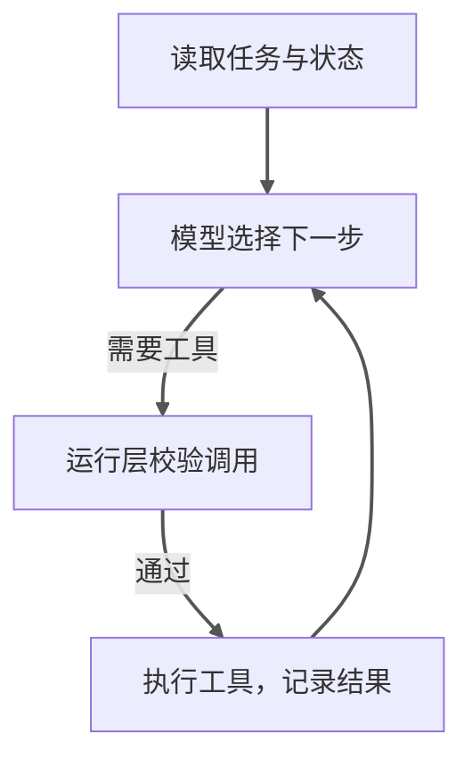
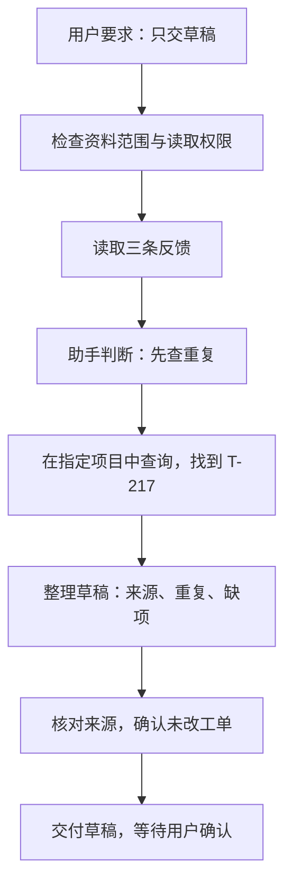

---
{"dg-publish":true,"dg-path":"Agent 应用指南/01 - Agent 如何工作.md","permalink":"/Agent 应用指南/01 - Agent 如何工作/","title":"Agent 应用指南（一）：一项任务如何变成连续行动","tags":["type/article","area/ai"],"created":"2026-10-12","updated":"2026-10-13","dg-note-properties":{"title":"Agent 应用指南（一）：一项任务如何变成连续行动","created":"2026-10-12","date":"2026-10-12","updated":"2026-10-13","tags":["type/article","area/ai"],"description":"用客户反馈转需求工单的案例，理解 Agent 的模型、工具、执行循环、上下文与状态，以及它和固定工作流的区别。","editorial_status":"待发布"}}
---

“把这批客户反馈整理一下，找出值得处理的问题，再建成需求工单。”

这句话对产品经理很自然，对软件系统却并不简单：反馈可能表达模糊，可能重复，也可能提到尚未确认的故障。系统不仅要生成文字，还要查询已有记录、决定是否补充信息，并处理创建工单带来的实际变化。

本系列面向普通开发人员和有少量技术背景的产品人员，围绕四个问题展开：Agent 如何工作、如何设计、为什么会失效，以及如何发现失效。不讨论模型训练，也不要求先掌握某个框架。

我们用一个**客户反馈处理助手**贯穿全系列。所有输入、日志和结果都是教学示例，不是已经部署或测得成功率的产品。

## 1. Agent 与聊天机器人的关键区别

让模型“总结下面十条反馈”，通常是一次内容生成。让它“查询反馈、检查已有工单、发现缺项就追问，最后整理成待确认草稿”，就需要根据途中得到的信息选择行动。

本文所说的 Agent，是由模型在约束内决定下一步、通过工具推进任务的系统。关键不是回复更长，也不是给它取一个专家名字，而是它开始参与执行控制。

可以把三种形式放在一起看：

| 形式 | 例子 | 下一步怎样确定 |
|---|---|---|
| 单次模型调用 | 对给定反馈生成摘要 | 调用一次后结束 |
| 工作流 | 取反馈 → 总结 → 固定格式输出 | 程序规定主要路径 |
| Agent | 查反馈后，根据缺项和重复情况选择查询、追问或出草稿 | 模型在边界内选择下一步 |

这不是严格互斥的产品分类。工作流内部也可以包含模型判断、动态分工和反馈循环；Agent 也可以调用一段确定性工作流。不能只凭“有循环”或“用了多个模型”判断。[1]

## 2. 模型负责提出行动，运行系统负责执行

一个最小可用的 Agent，可以从几个部件理解：

| 部件 | 做什么 | 在案例里是什么 |
|---|---|---|
| 模型 | 理解材料、选择下一步 | 判断是否需要查已有工单 |
| 任务与规则 | 定义目标、范围和停止条件 | 只准备草稿，不擅自创建 |
| 工具 | 提供读写外部系统的接口 | 查询反馈、搜索工单、创建工单 |
| 上下文 | 本次判断实际看到的信息 | 当前请求、已取回的反馈、工具结果 |
| 状态 | 记录任务走到了哪里 | 已处理反馈、草稿、确认与执行记录 |
| 运行层 | 调模型、执行工具、检查权限、保存过程 | 把模型请求转换为真实接口调用 |

运行层常被称为运行与控制框架（Harness）。你使用 Agent 框架或现成产品时，它可能已经提供其中不少功能，但仍要核对这些功能在当前配置里是否存在。

模型生成“创建工单”的请求，不等于工单已经创建。运行层要检查工具、账号、目标项目和授权，再执行接口调用。最终是否成功，还要看外部系统的真实结果。

## 3. 一次任务如何运行

先看最核心的行动循环。图中只保留工具调用的主循环，交付、等待和停止情况放在图下解释：

**图 1：看结果，再决定下一步。** 工具返回的信息进入下一轮判断，不是预先写死一串调用。图中画的是仍需工具时的路径；模型也可以选择等待用户，或在满足条件后验证结果、交付并结束，而不是无限绕圈。

这是一张主流程示意图，不是完整控制逻辑。每轮都要核对权限、预算和停止条件；工具校验被拒绝时不能执行，需要用户补充或确认时应等待。验证未通过且仍可修复时，带着失败证据继续判断；无法修复、需要裁决或用户说“停止”时，应停止相关动作并说明原因，不能再按旧计划发起调用。

以下是一个简化的执行记录。它展示可观察的动作，不是模型内部完整思维过程。

| 步骤 | 可观察到的动作 | 对后续的影响 |
|---|---|---|
| 1 | 用户要求整理指定批次反馈，只交草稿 | 创建工具暂不可执行 |
| 2 | 查询反馈，得到一条“导出失败”的描述 | 需要保留原文，不能直接写成已确认缺陷 |
| 3 | 搜索已有工单，找到相似记录 | 比较范围，标记可能重复 |
| 4 | 发现反馈没有版本和复现步骤 | 草稿列出缺项，不虚构测试结果 |
| 5 | 输出候选工单、来源和待确认事项 | 草稿阶段结束 |
| 6 | 用户确认具体草稿并要求创建 | 进入已获授权的执行阶段 |
| 7 | 创建并读取目标工单 | 核对标题、项目、内容与记录标识 |

它不是每一步都“自由发挥”。查询范围、能调用的工具、能否创建、什么时候结束，仍需要系统约束。

### 看一次具体输入：不是每条反馈都应该变成新工单

用户说：“整理下面三条反馈，只给我工单草稿，不要创建。”以下标识和内容均为虚构教学数据：

| 反馈 | 原文 | 初步观察 |
|---|---|---|
| F-101 | “桌面版 2.4 导出大文件时出现 E42，没有保存成功。” | 有版本与现象，但缺文件大小和复现步骤 |
| F-102 | “桌面版 2.4 导出失败，提示 E42。” | 与 F-101 相似，不宜直接再建一张 |
| F-103 | “希望导出列表能按时间排序。” | 功能建议，不是已确认缺陷 |

查询现有工单后，找到 T-217：“桌面版 2.4 大文件导出 E42，待复现。”合理的草稿可以是：

> **候选问题：**桌面版 2.4 导出出现 E42。  
> **来源：**F-101、F-102。  
> **重复情况：**与 T-217 疑似重复，建议人工核对是否补充到原单。  
> **缺项：**文件大小、操作步骤、稳定复现情况、影响范围。  
> **单独建议：**F-103 记为排序功能建议，优先级待产品确认。  
> **执行状态：**只生成草稿，没有创建或修改工单。

这里至少有两处判断不能靠简单搬运：把相似反馈归到一起，以及把功能建议与缺陷报告分开。查询工具提供事实，模型组织候选判断，运行层保证不发生未经授权的写入。

**图 2：从三条反馈到一份可确认的草稿。** 沿箭头从上往下读即可：先取原文，再查重复，最后整理并检查草稿。查询工具负责取回资料，助手根据资料作判断；图中没有创建步骤，因为用户只批准了草稿，后续创建需要新的明确授权。

## 4. 三个常见误解

### “模型知道怎么做，就能做”

不一定。它可能知道工单系统的使用方法，但当前系统没有连接器，账号没有权限，或者查询范围绑定错了。这是能力接入问题，不是再写一段提示词就能解决的问题。

### “聊过的事情，它都记得”

不一定。上下文窗口是当前可见的信息，历史记录和持久状态需要被保存、检索并重新带入。保存过，不等于此刻看到了；看到摘要，不等于掌握了全部原始证据。

### “它说完成了，就完成了”

不一定。它可能只写好了草稿，可能接口报错，也可能建到了错误项目。需要区分内容生成、实际执行和结果验证。第四篇会专门讨论这个问题。

## 5. 什么时候值得使用 Agent

先问：这项任务的路径是否经常变化？是否需要结合文本与环境信息作出选择？完成条件能否说清楚？

- 路径固定、规则明确：优先考虑普通程序或工作流。
- 只需要改写与摘要：先试单次模型调用。
- 路径随材料变化，但目标可验收：再考虑 Agent。
- 连目标都没定义：先澄清需求，不要让 Agent 无限探索。

Agent 的灵活性通常伴随更多延迟、费用和失败面。OpenAI 与 Anthropic 的指南都建议从简单可行的方案开始，而不是默认选择最复杂的编排，也就是安排模型和工具协同工作的方式。[1][2]

## 本篇小结

理解 Agent，先抓住三个事实：

1. 模型参与决定下一步，但动作由运行系统执行。
2. Agent 通过工具反馈推进任务，不是一次生成所有答案。
3. 好坏取决于模型、工具、数据、状态和约束的组合。

下一篇将把客户反馈助手从一句需求，变成一份可以实现、测试和验收的设计。

## 来源与边界

- [1] Anthropic，**Building effective agents**，章节 **What are agents?**、**When (and when not) to use agents**、**Agents**。原文区分预定义路径和模型主导执行，并强调来自环境的反馈。https://www.anthropic.com/engineering/building-effective-agents
- [2] OpenAI，**A practical guide to building agents**，第 4 页 **What is an agent?**、第 5—6 页 **When should you build an agent?**、第 13 页 **Orchestration**、第 16 页 **When to consider creating multiple agents**。https://cdn.openai.com/business-guides-and-resources/a-practical-guide-to-building-agents.pdf

以上是工程指南的定义与建议，不是行业唯一术语标准。本文案例、流程图和任务拆分为教学设计；没有提供实测效果或推荐某个特定的软件开发工具包（SDK）。

## 系列导航

[系列入口](https://nexus.sigmoid.cc/Agent%20%E5%BA%94%E7%94%A8%E6%8C%87%E5%8D%97/00%20-%20Agent%20%E5%BA%94%E7%94%A8%E6%8C%87%E5%8D%97/) · 下一篇：[从一句需求到可验收的设计](https://nexus.sigmoid.cc/Agent%20%E5%BA%94%E7%94%A8%E6%8C%87%E5%8D%97/02%20-%20%E5%A6%82%E4%BD%95%E8%AE%BE%E8%AE%A1%E5%A5%BD%E7%9A%84%20Agent/)
