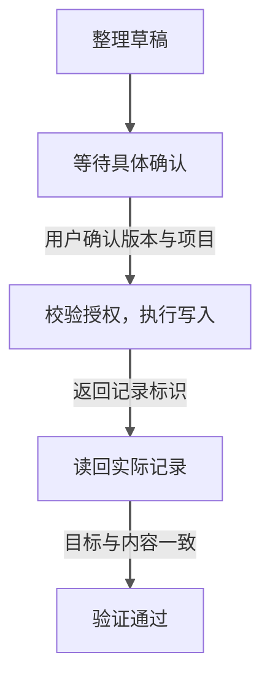
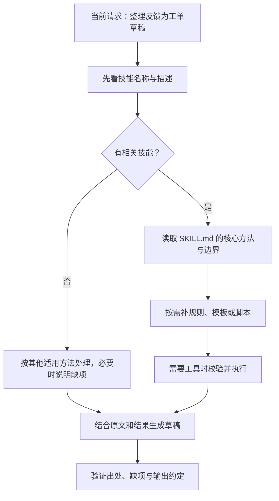

---
{"dg-publish":true,"dg-path":"Agent 应用指南/02 - 如何设计好的 Agent.md","permalink":"/Agent 应用指南/02 - 如何设计好的 Agent/","title":"Agent 应用指南（二）：从一句需求到可验收的设计","tags":["type/article","area/ai"],"created":"2026-10-12","updated":"2026-10-13","dg-note-properties":{"title":"Agent 应用指南（二）：从一句需求到可验收的设计","created":"2026-10-12","date":"2026-10-12","updated":"2026-10-13","tags":["type/article","area/ai"],"description":"用客户反馈处理助手，逐步设计任务约定、工具、上下文、Skill、授权与停止条件，形成可交给开发和测试的工作纸。","editorial_status":"待复审"}}
---


“做一个可以处理客户反馈的 Agent”，不是完整的开发需求。

它可能意味着总结，也可能意味着自动创建工单、设优先级、分派负责人，甚至回复客户。这些行为的成本与责任不同，不能用“智能处理”四个字带过去。

本文继续使用客户反馈助手：读取指定反馈、查已有工单、生成候选草稿；具体工单得到用户确认后，才允许创建。案例与配置均为设计示意，不是已经运行的系统。

先选一个足够小的任务：“把‘希望导出列表按时间排序’写成一份草稿，不提交。”它只需要保留原意、列出待确认细节。

再增加一层：“整理导出失败的反馈，查询已有工单。”这时才需要工具、查重和相关资料。最后才考虑“处理多批反馈，经确认后创建，能在中断后继续”，这时才需要持久进度、确认版本和安全恢复。

下面的完整设计针对后两层，不代表一个简单分类或改写任务也需要所有机制。先把简单任务做清楚，再为真实增加的复杂度补设计。

## 1. 先写任务约定，再选框架

设计的第一件事，不是决定用哪个模型，而是明确系统最终应交付什么。

| 设计项 | 本例的约定 |
|---|---|
| 目标 | 把反馈转成有依据、可继续处理的工单草稿 |
| 输入 | 指定批次反馈、可访问的已有工单与产品资料 |
| 输出 | 草稿、来源、疑似重复项、缺失信息、建议理由 |
| 不可猜测 | 复现结果、受影响人数、负责人承诺、已确认优先级 |
| 默认权限 | 读取指定集合、生成草稿；不能创建或修改正式记录 |
| 执行授权 | 用户确认具体草稿与目标项目后才能创建 |
| 完成条件 | 草稿有出处且没有无依据的字段；执行后目标记录与确认内容一致 |
| 停止条件 | 需要确认、权限不足、预算达到上限或重试耗尽 |

“分析完成”“等人确认”“创建完成”“验证通过”是不同状态。界面和任务记录都应区分，而不是统一显示“完成”。下面只画正常完成时的主路径，变更和异常在图后解释。



**图 3：草稿就绪，不等于已经创建；创建完成，也不等于验证通过。** 用户未确认时停在等待，确认失效或内容、目标改变时重新确认，运行层校验不通过时不得执行。超时进入“结果未知”，先核对而不是直接重试；无法核实或读回不一致时停止或请人处理。第三篇图 6 专门展开超时恢复。执行中的取消不能自动撤销已经发生的写入。

### 把约定写成可检查的输入输出

下面仍是虚构案例：项目是“桌面产品”，用户批准本批次读取和草稿，不批准正式写入。一个草稿应有明确字段，而不是只有一段流畅描述：

| 字段 | 示例值 | 检查方式 |
|---|---|---|
| 标题 | 导出失败反馈，待核实 | 是否把反馈当成已经证实的故障 |
| 来源 | 两条反馈的原文或链接 | 能否回到对应反馈 |
| 可能关联 | 已有的“导出失败”工单，疑似重复 | 是相似线索，还是已经确认的同一问题 |
| 缺项 | 软件版本、操作步骤、复现情况 | 是否把未知项留为未知 |
| 优先级 | 待产品确认 | 是否擅自承诺排期 |
| 执行状态 | 草稿，未写入 | 外部记录是否确实未改变 |

如果用户随后说“确认新增”，仍要先处理疑似重复的问题，明确他批准的是补充原单还是创建新单。不能把一句笼统认可解释成所有写操作都获准。

产品人员应主导目标与边界，开发人员负责把它们变成真实机制，测试人员把它们变成可重复的检查。三者应在开发之前对同一份任务约定达成一致。

把验收落实到一个反例：用户确认在“桌面产品”创建排序建议，接口返回“创建成功”，读回记录却属于“移动产品”。这应判为验收失败，停止后续动作并请人处理，不能报告“任务完成”。恢复配置也不会把错误记录自动移回正确项目。

在这个过程中，模型可以辅助对照原文、列缺项；程序检查必填字段、调用范围和真实记录；产品或有权的用户确认业务决定。测试人员用固定输入检查这些机制是否有效。不能让最后一句“已检查”承担所有验收。

## 2. 先用一个 Agent，把一条路径跑完整

本例的第一版不需要“反馈分析 Agent”“需求规划 Agent”“优先级 Agent”三个角色轮流传文档。

一个 Agent 配合清晰工具，就可以先跑通：

> 读取反馈 → 查询已有工单 → 生成草稿 → 等待确认 → 创建 → 读回验证。

这叫一个完整的纵向切片：不是把所有模块分别做到一半，而是让一项小任务从输入走到验收。

如果复杂指令持续无法维护，或相似工具反复误选，先澄清指令、参数与工具职责。改善后仍无效，才考虑拆成多个 Agent。独立来源研究也可以并行，但要测量实际收益，不以角色数量作为成熟度指标。[1]

## 3. 工具设计要让错误难发生

下面的名字只是应用程序接口（API）的职责示意，不是可以直接运行的实现：

| 工具职责 | 应明确的输入 | 应返回的信息 |
|---|---|---|
| 查询反馈 | 集合、批次、范围 | 原文、来源标识、时间、分页状态 |
| 搜索工单 | 项目、关键词或过滤条件 | 记录标识、匹配内容、查询范围 |
| 创建工单 | 项目、已确认草稿、执行标识 | 创建结果、工单标识、明确错误 |
| 读取工单 | 项目、工单标识 | 实际标题、内容、状态与版本 |

**执行标识**用来关联同一次建单尝试。安全重试应沿用它；换成另一份草稿，不能复用旧标识。是否防重复，还取决于服务端接口是否真正支持相应机制，不是给请求起个名字就够了。

### 不把读写混在一个模糊入口里

“处理工单”是个危险的工具名：它究竟查询、修改还是删除？读写职责分开，更利于模型选择，也更利于权限控制。

### 不隐藏查询范围和缺失

搜索返回零条，可能是确实没有，也可能查错项目、权限不足或只取了第一页。工具返回应让这些情况可区分。

“不知道有没有重复工单”和“已证实没有重复工单”，不是同一个结论。

一次搜索可以这样读（中文字段为教学示意，不是可运行的 API）：

```text
输入：项目是桌面产品，关键词是导出失败，不依赖工具默认项目。
返回：当前页有“导出失败，待复现”的工单；还有下一页。
后续：继续核对后续页，再比较相似工单与当前反馈；无法取全就说明范围未完整。
```

这里返回了匹配内容和覆盖情况，模型才有依据决定继续查询还是整理草稿。仅返回“搜索成功”，不足以支持“没有重复”的结论。[2]

### 设计有副作用操作的重试

创建请求超时，不等于创建失败。接口可能已经写入，只是回执丢了。

应优先使用服务端支持的幂等机制，也就是让同一操作重复请求时不产生额外结果：同一建单请求重试，不产生第二条记录。先查已有状态也是补救方法，但并发条件下，单纯“先查后写”并不保证不重复。

还应明确已有记录被其他人修改时怎么办：拒绝覆盖、提示冲突，还是在特定规则下合并。不能交给模型临时猜。

## 4. 上下文不是越多越好，而是足够且相关

本次判断需要的是当前反馈、相关工单、产品术语和操作约定，而不是全部历史资料。

一种实用分工是：

| 内容            | 放在哪里         |
| ------------- | ------------ |
| 角色与始终适用的边界    | 简短的常驻指令      |
| 本次目标、授权、已完成动作 | 任务状态         |
| 反馈与原始证据       | 可检索资料；带来源标识  |
| 同类工作的处理方法     | 按需加载的 Skill  |
| 密码、令牌         | 凭据系统，不放入工作说明 |

最小上下文不等于最短上下文。删掉必要的产品定义，会使模型误判；塞进大量无关文件，也会增加噪声和成本。[3]

### 分清当前上下文、长期资料和任务状态

三者不是一回事。当前上下文像这一轮摊在桌上的材料；资料库像文件柜；任务状态像持续更新的办理记录。文件柜里有文件，不等于桌上有；桌上有一句“已完成”，也不等于办理记录和外部结果都已经核对。

模型这轮应看到必要规则、当前请求、工具说明、相关结果和已加载的方法。大量原文留在资料库按需取回；任务目标、进度、授权对象和外部结果则要可靠保存，并在继续时读取。比喻只是帮助区分用途，不代表模型会自动管理这三层。

### 长任务怎样应对 compact

上下文压缩（compact）把较早历史整理成更短的表示，为后续材料留空间。用户最初说“把多批反馈整理成草稿，先别创建”，助手处理一部分后，对话变长。若压缩后的材料只留下“继续处理反馈”，后续就可能忘记“先别创建”或重新做已完成的部分。

一种实用设计是保存简短的继续记录：

| 必须保存的事实 | 本例写成什么 |
|---|---|
| 当前目标和范围 | 只处理指定产品的这些反馈，交草稿 |
| 当前授权 | 尚未批准任何创建或修改 |
| 进度 | 已整理导出问题；排序建议还没整理 |
| 证据位置 | 反馈原文和查到的相似工单可从哪里读取 |
| 外部动作 | 本次尚未写入；如已写入，另存真实回执和目标记录 |
| 下一步 | 继续写排序建议草稿，不重做已完成部分 |

“继续记录”不是把聊天另存一遍：它只保留后续必须知道的事实。压缩前更新记录，继续时重新加载并核对；工具结果很长时保存原始结果的位置，不要求摘要复制所有细节。用户随后改变要求，应更新记录，不能凭旧摘要继续旧计划。

compact、清理旧工具结果、长期记忆也不相同：压缩减少当前历史的体积；工具结果清理移出旧返回，需要时再读取；长期记忆把选定内容存到外部，是否进入下次上下文仍取决于取回机制。[8] 并非每个产品都有这三项，也没有通用的固定触发阈值。

关键授权和真实执行状态不能只靠一句自由文本摘要维护。这是本文的业务设计建议，不是 compact API 自动提供的保证。

## 5. Skill 应该怎样组织

技能包（Skill）是可复用的任务方法、资料和可选脚本，不是新模型，也不是业务权限。[4][5]

对本例，一个“反馈转工单草稿”技能可以这样组织：

```text
feedback-to-ticket/
  SKILL.md                 使用边界、输入输出、流程与验收
  references/              分类规则、术语、特殊情况
  assets/                  工单草稿模板
  scripts/                 可选的格式或重复检查程序
```

测试用例可以放在项目的评估目录，与 Skill 版本关联；不是开放规范要求必须包含的子目录。

### 描述负责选择，正文负责方法

描述应写成：“当用户要求把客户反馈整理为需求或缺陷工单草稿时使用；保留出处和缺项；不用于自动回复客户，不自行提交正式工单。”

这比“专业产品专家，高效解决一切问题”更容易和相邻技能区分。

正文则说明：确认范围、取得反馈、区分事实与判断、输出草稿、列出缺项、检查验收标准。查重应按具体任务要求进行，不因选中了技能就自动增加查询。

### 先发现，再按需读入

加载技能并运行 Agent 的应用或框架，通常叫作**宿主**。它先提供名称与描述供模型选择，再通过读取机制取得 `SKILL.md` 的正文，把方法带入当前上下文；有些宿主也允许用户直接选技能。这种先看目录、再取方法、按需补资料的做法叫渐进披露。[4][5]

目录里有文件，不等于这轮已读到它。需要分类规则时再读参考资料，需要格式时再读模板；实际查询或脚本运行仍由执行环境完成，返回结果供模型继续使用。下面直接看它怎样影响一次小任务。

### 具体例子：一份很小的 Skill，怎样改变工作方法

先不用查询工具。用户给两句原文：“导出文件时提示失败”“希望列表按时间排序”，要求“整理成草稿，不要提交”。

系统能看到两个技能的简短描述：

- **反馈转草稿**：把客户反馈整理为故障或功能建议草稿，保留原文与缺项。
- **会议纪要**：把会议讨论整理成决定和待办。

本次适用的是前者。助手接着读到它的 `SKILL.md`。一个足够小的教学版本可以写成：

```text
---
name: feedback-to-ticket
description: 整理客户反馈为工单草稿；保留原文与缺项，不自行提交。
---

1. 分清故障反馈和功能建议，不把建议写成已确认故障。
2. 没有软件版本、操作步骤或复现结论时，标为待补充，不猜。
3. 每份草稿保留来源原文，用模板中的标题、类别、缺项字段输出。
4. 用户要求查重且具备相应读取范围时，查询已有工单，再写关联情况。
5. 未获具体提交授权，只交草稿，不创建或修改记录。
```

这里的关键是正文中的处理规则，文件本身不会自动运行这五步。助手根据当前任务使用它们：读取草稿模板，但**不需要查询工单、不需要读完整的产品故障手册，也不需要运行脚本**，因为用户这次只要求整理给定文字。

按这个方法，草稿可以是：

> **导出失败**：故障反馈，尚未核实。来源是“导出文件时提示失败”；软件版本、操作步骤和复现情况待补充。  
> **按时间排序**：功能建议。来源是“希望列表按时间排序”；排序方向和适用页面待确认。  
> **本次状态**：只生成草稿，没有提交；本次未查询已有工单，不能宣称已经排除重复。

如果用户追加“再查一下有没有重复”，才进入第一篇的工具查询例子：校验项目范围，真实查询，把返回结果带入下一轮，补充草稿关联。不是安装 Skill 后就默认把所有工具都运行一次。

这说明三件事：**描述帮助找到方法，正文提供实际规则，资源和工具按任务需要使用。** 模型即使没有这个技能，也可能写出相同答案；Skill 的作用是让团队能明确维护、复用和测试方法，不是保证“有技能必然正确、没技能必然错误”。

脚本只是可选的确定性处理手段，比如检查草稿字段有没有漏填；执行脚本通常可只返回检查结果，并不要求把脚本全文塞入上下文。

因此，**Skill 改变的是模型这次可采用的方法与资料，不是换了一个模型，也不是启动了另一个 Agent。** 它也不自动扩大权限。发现、加载与执行的具体工具因宿主而异，规范提供的是文件和渐进加载约定，不保证任何平台都照同一条固定路径运行。[4][5]

按需加载减少无关材料，但不是无限记忆；已加载的内容仍占上下文，宿主也可能截断发现列表。安装了 Skill，不保证每次能选中。



**图 4：技能先被发现，再按需展开。** 附加资料、脚本和工具都是“有需要才使用”，不是每次必做；已有材料足够时可以直接形成草稿。没有相关技能也要验证结果，选中技能不等于获得写权限。

用第一篇的反馈做一个触发对照：

| 用户表达 | 是否应使用“反馈转草稿”技能 | 预期动作 |
|---|---|---|
| “把这三条反馈整理成工单草稿。” | 是 | 保留来源、分组、列缺项，不默认增加查重 |
| “帮我整理几个能交给研发的问题。”并附相同反馈 | 是 | 识别自然表达，不要求背出技能名字 |
| “整理草稿，并在指定项目查一下重复。” | 是 | 范围与读取权限具备时真实查询；缺范围就先澄清 |
| “什么是需求工单？” | 否 | 解释概念，不查客户资料、不建单 |
| “我只想统计反馈条数，不要分析内容。” | 否 | 做统计，不额外启动工单分析 |

这个技能有没有价值，不取决于描述里写了多少“专业能力”，而取决于这些相邻请求能否被区分，并且选中后能否交付正确结果。

### 用一个源头维护方法

不把同一规则复制到多个角色提示词、技能和项目说明中。业务 Skill 保存稳定方法，任务记录保存本次目标与进度，共享规则集中维护。

需要可重复的程序检查或外部接口时再写脚本，不要求每个技能都有代码。脚本应约定清楚：成功返回什么、失败怎样报告、调用方如何判断结果；外部材料里的指令仍是不可信资料，不能因为进入工具结果就获得授权。

用上面的触发表测试“该用”和“不该用”，再加入“整理草稿，但不要查询客户身份资料”等范围限制。触发正确只是第一关；例如任务要求查重，轨迹却没有查询，即使选中了技能也应判执行失败。第四篇再展开来源、产物与外部状态怎样一起验收。[6]

## 6. 把权限和停止条件落实到运行层

写在提示词里的“不要越权”有用，但不足以形成可靠控制。

至少要落实：

- 当前执行身份能访问哪些反馈集合和项目；
- 未确认时，写入工具不可执行，或请求会被拒绝；
- 确认对应具体草稿版本与目标，不能用旧确认批准新内容；
- 限定时间、成本、工具调用或重试预算；
- 遇到凭据失效和权限不足，停止相关操作，不借用其他账号；
- 工具失败后能报告部分完成，而不是伪造成功。

读取也可能暴露隐私。低风险自动执行必须建立在明确授权和数据范围上，不代表所有只读操作都可以默认放行。[1][7]

## 7. 开发前的交付清单

现在可以把设计交给团队，而不是只交一段提示词（Prompt）：

1. 任务约定和状态定义；
2. 工具输入、返回、错误与幂等约定；
3. 数据来源、身份和权限范围；
4. Skill 的入口、方法与依赖；
5. 正常、缺项、冲突、失败、越权的评估用例；
6. 日志、外部结果验证与人工接管方式；
7. 模型、指令、工具与技能版本记录。

先让这些内容支持一个小任务可靠完成，再优化速度、成本和更大的自主范围。

## 来源与边界

- [1] OpenAI，**A practical guide to building agents**，第 11 页 **Configuring instructions**、第 16 页 **When to consider creating multiple agents**、第 24 页 **Guardrails**、第 31 页 **Plan for human intervention**。https://cdn.openai.com/business-guides-and-resources/a-practical-guide-to-building-agents.pdf
- [2] Anthropic，**Writing effective tools for agents — with agents**，**What is a tool?** 与 **How to write tools** 及工具设计原则。支持清晰接口、返回信息与实际评估的方法；本文工具表为设计示意。https://www.anthropic.com/engineering/writing-tools-for-agents
- [3] Anthropic，**Effective context engineering for AI agents**，**The anatomy of effective context**、**Context retrieval and agentic search**、**Context engineering for long-horizon tasks → Structured note-taking**。https://www.anthropic.com/engineering/effective-context-engineering-for-ai-agents
- [4] Anthropic，**Equipping agents for the real world with Agent Skills**，**The anatomy of a skill**、**Developing and evaluating skills**。https://www.anthropic.com/engineering/equipping-agents-for-the-real-world-with-agent-skills
- [5] OpenAI，**Build skills**，**How ChatGPT and Codex use skills**、**Best practices**；Agent Skills，**Specification**，**`SKILL.md` format**、**Progressive disclosure**。https://learn.chatgpt.com/docs/build-skills ；https://agentskills.io/specification
- [6] OpenAI，**Testing Agent Skills Systematically with Evals**，§4 **Use a small, targeted prompt set to catch regressions early**。https://developers.openai.com/blog/eval-skills
- [7] OpenAI，**Safety in building agents**，**Keep tool approvals on**、**Combine techniques**。本文引用安全方法，不推荐其正在弃用的产品界面作为长期默认方案。https://developers.openai.com/api/docs/guides/agent-builder-safety
- [8] Anthropic，官方 Cookbook，**Context engineering: memory, compaction, and tool clearing**，**Compaction**、**Summary: What Each Primitive Does**。原文区分会话压缩、旧工具结果清理和外部持久记忆；本文继续记录表为业务设计。https://platform.claude.com/cookbook/tool-use-context-engineering-context-engineering-tools

工具设计参考 [2]；任务表、目录示例和开发清单是本文的应用建议。本文不声称完成了连接器实现、权限验证或上线测试。

## 系列导航

[系列入口](https://nexus.sigmoid.cc/Agent%20%E5%BA%94%E7%94%A8%E6%8C%87%E5%8D%97/00%20-%20Agent%20%E5%BA%94%E7%94%A8%E6%8C%87%E5%8D%97/) · 上一篇：[一项任务如何变成连续行动](https://nexus.sigmoid.cc/Agent%20%E5%BA%94%E7%94%A8%E6%8C%87%E5%8D%97/01%20-%20Agent%20%E5%A6%82%E4%BD%95%E5%B7%A5%E4%BD%9C/) · 下一篇：[它为什么会失效，以及先查哪里](https://nexus.sigmoid.cc/Agent%20%E5%BA%94%E7%94%A8%E6%8C%87%E5%8D%97/03%20-%20Agent%20%E4%B8%BA%E4%BB%80%E4%B9%88%E5%A4%B1%E6%95%88/)
